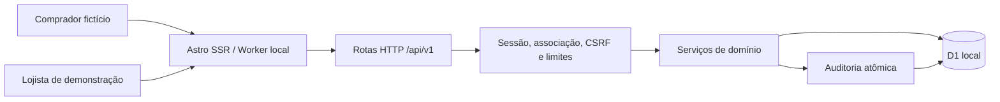

# Arquitetura implementada · 20/10/2026

## D-001 · Astro SSR + Workers + D1

Aplicação única em TypeScript. Astro 7.4.1, adapter oficial `@astrojs/cloudflare` 14.4.1 e Wrangler 4.151.2. Binding `DB` acessado por `cloudflare:workers`. `compatibility_date=2026-10-19`, data suportada pelo binário instalado. Node validado: 24.19.0. Versões completas fixadas no lockfile.

A prova S0-01 executou antes do checkout: consulta de duas lojas, filtro de tenant, rollback real de `D1.batch()` e autenticação/sessão no workerd. Não há adapter Node substituindo Workers nos testes. A prova está em `tests/spike.test.ts` e `tests/auth.test.ts`.

`src/lib` contém autenticação, catálogo, regras de pedidos e roteamento HTTP; recebe `D1Database` por argumento. `src/pages` implementa telas SSR e a entrada API. `src/scripts` cuida de interação no navegador sem biblioteca de SPA. Assets e fontes são locais. Não há chamadas de mapas, clima, banco, WhatsApp ou analytics.

## D-002 · Sessões próprias de demonstração

Autenticação demonstrativa segregada. O modo `APP_MODE=local-demo` exige host loopback. A homologação `APP_MODE=staging-demo` exige HTTPS, host autorizado e JWT Cloudflare Access válido. Duas contas sintéticas são provisionadas pelo seed. Senhas de teste derivadas com PBKDF2-SHA256/100 mil iterações; fixtures públicas, inadequadas para produção. Sessões usam tokens aleatórios de 256 bits, somente hash no D1, expiração de oito horas, rotação no login e revogação no logout. Toda autorização consulta usuário, loja e associação ativos.

Cookie host-only `HttpOnly; SameSite=Strict`, com `Secure` quando há HTTPS. HTTP só é aceito no laboratório local. Mutações exigem mesma origem e JSON; as administrativas também exigem `X-CSRF-Token`. O token CSRF só é fornecido ao lojista autenticado. O login limita tentativas antes da KDF. `Astro Sessions` está desativado; nenhum KV de sessão é necessário.

A migração 0005 revoga sessões quando vínculo, papel, credenciais ou ativação mudam. O login revalida esses dados ao persistir a sessão, impedindo uma transferência durante a verificação da senha. A garantia depende de uma única associação por usuário (`UNIQUE(user_id)`). Veja a [auditoria de isolamento](AUDITORIA_ISOLAMENTO.md).

A homologação usa Cloudflare Access e banco/bindings próprios, conforme o [guia de hospedagem](HOSPEDAGEM_CLOUDFLARE.md). Antes de P2: escolher autenticação de produção, recuperação, reautenticação e política de senhas/credenciais. A aplicação bloqueia a execução fora dos hosts/modos autorizados e quando falta a configuração de acesso.

## D-003 · Integridade e concorrência

Preços, região, disponibilidade e frete são resolvidos no servidor. Dinheiro usa inteiros em centavos. Preço/título são copiados para `order_items`; alterações posteriores de catálogo não modificam o pedido.

Cada checkout recebe um intento aleatório emitido pelo servidor e vinculado à loja. O banco impõe unicidade por `(store_id,intent_hash)`; um hash canônico de payload detecta reutilização com conteúdo diferente. Pedido, itens, pagamento inicial e auditoria são gravados em um único `batch()`. A restrição única decide os reenvios concorrentes; a leitura anterior é apenas uma otimização.

O link externo é um HMAC com chave aleatória gerada no banco, derivado do intento e da loja; só seu hash fica no pedido. Assim o mesmo intento recupera o mesmo link após perda de resposta sem armazenar o token público bruto. A consulta expira em 30 dias e respeita revogação. O browser mantém o intento e os dados do envio em `sessionStorage` enquanto a resposta é incerta. O carrinho usa armazenamento separado por slug.

Transições usam versão otimista. Alteração e auditoria pertencem à mesma transação; `changes()` condiciona o evento à mutação efetiva. Propostas de frete são versionadas, têm prazo e validade; uma proposta antiga ou expirada não pode ser aceita. Eventos não podem ser atualizados ou apagados pela aplicação. Testes provocam falhas na auditoria para conferir rollback de criação, transição e conferência simulada.

## D-004 · Pagamento e privacidade

Pedido e pagamento têm máquinas de estado separadas. Todos os estados financeiros começam com `SIMULATED_`. Não existe `bank_reconciled`, chave Pix, BR Code, upload de comprovante ou transferência nesta P1. Uma declaração tardia não reativa um pedido finalizado/cancelado.

O comprador vê itens, valores, andamento, proposta e dados comerciais fictícios da loja; não recebe nome, contato ou endereço de entrega do comprador, hashes internos ou o histórico administrativo completo. Somente o painel autorizado pode consultar os dados necessários ao atendimento. Nenhum CPF é solicitado.

As respostas públicas usam projeções explícitas, incluindo os produtos embutidos no HTML. O link do último pedido deixa de ser persistido em `localStorage`: a associação temporária fica na aba, e é descartada após abrir o acompanhamento. Carrinhos seguem separados por slug.

Logs estruturados de criação contêm correlação, linhas lidas/escritas e duração D1; não contêm nome, contato, endereço ou token. A auditoria registra fatos gerados no servidor e não confia em eventos fornecidos pelo browser. Headers impedem cache de páginas dinâmicas, referência externa, enquadramento e indexação. Telemetria comportamental está ausente.

## D-005 · Backup para o futuro piloto

Para P1, exportação e restauração são locais e verificadas em armazenamento separado por execução. Para P2, a escolha é exportação D1 agendada para armazenamento de objetos **fora da conta/provedor primário**, com cifragem, credencial exclusiva, retenção definida e exercício de restore separado. O provedor externo e os parâmetros de retenção/RPO/RTO dependem da conta e do piloto; nenhum foi contratado ou testado. Time Travel não substitui esse backup. O comando atual não atende ao gate de backup externo de P2.
